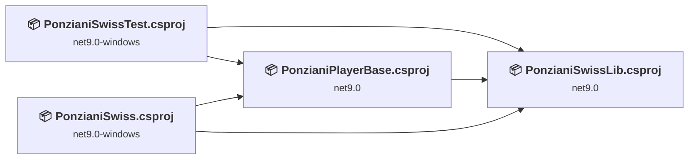
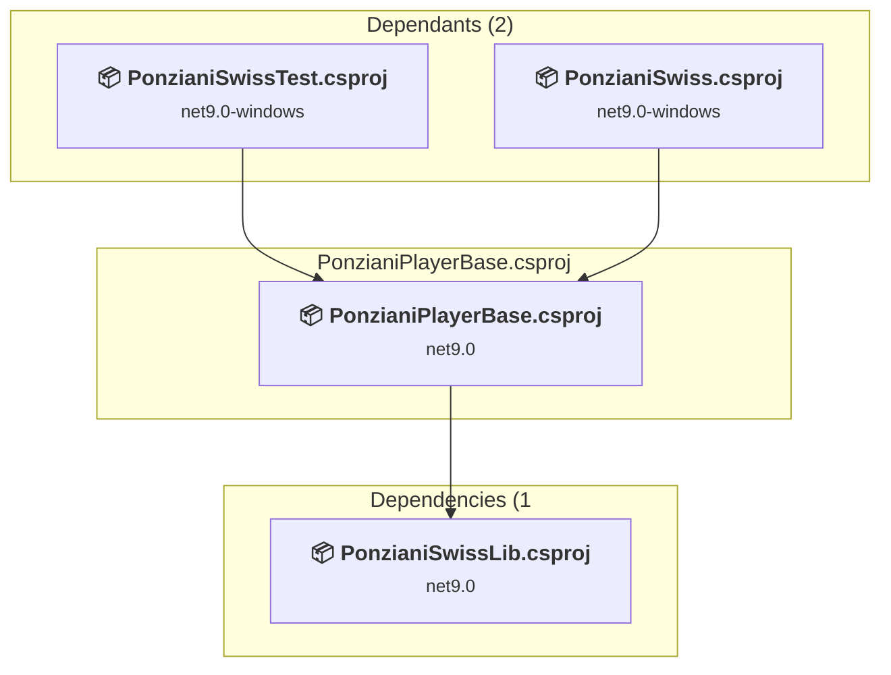
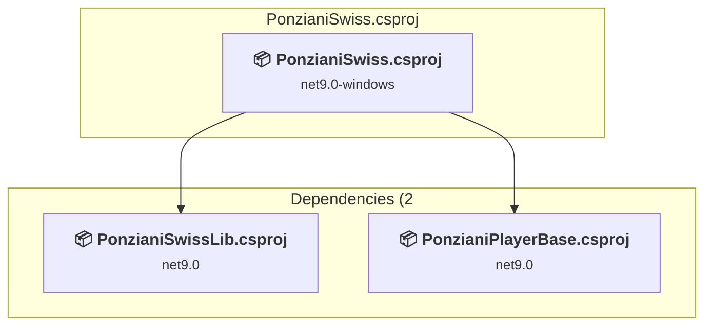
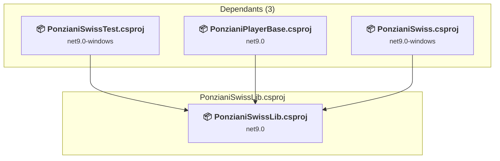
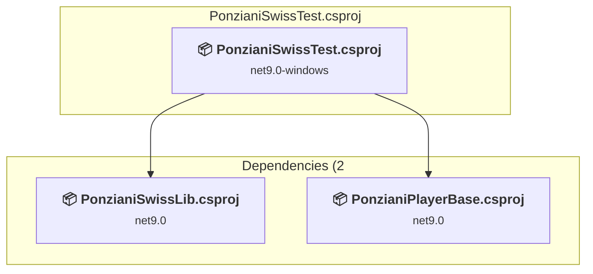

# Projects and dependencies analysis

This document provides a comprehensive overview of the projects and their dependencies in the context of upgrading to .NETCoreApp,Version=v10.0.

## Table of Contents

- [Executive Summary](#executive-Summary)
  - [Highlevel Metrics](#highlevel-metrics)
  - [Projects Compatibility](#projects-compatibility)
  - [Package Compatibility](#package-compatibility)
  - [API Compatibility](#api-compatibility)
- [Aggregate NuGet packages details](#aggregate-nuget-packages-details)
- [Top API Migration Challenges](#top-api-migration-challenges)
  - [Technologies and Features](#technologies-and-features)
  - [Most Frequent API Issues](#most-frequent-api-issues)
- [Projects Relationship Graph](#projects-relationship-graph)
- [Project Details](#project-details)

  - [PonzianiPlayerBase\PonzianiPlayerBase.csproj](#ponzianiplayerbaseponzianiplayerbasecsproj)
  - [PonzianiSwiss\PonzianiSwiss.csproj](#ponzianiswissponzianiswisscsproj)
  - [PonzianiSwissLib\PonzianiSwissLib.csproj](#ponzianiswisslibponzianiswisslibcsproj)
  - [PonzianiSwissTest\PonzianiSwissTest.csproj](#ponzianiswisstestponzianiswisstestcsproj)

## Executive Summary

### Highlevel Metrics

| Metric | Count | Status |
| :--- | :---: | :--- |
| Total Projects | 4 | All require upgrade |
| Total NuGet Packages | 31 | 11 need upgrade |
| Total Code Files | 33 |  |
| Total Code Files with Incidents | 6 |  |
| Total Lines of Code | 10593 |  |
| Total Number of Issues | 37 |  |
| Estimated LOC to modify | 22+ | at least 0,2% of codebase |

### Projects Compatibility

| Project | Target Framework | Difficulty | Package Issues | API Issues | Est. LOC Impact | Description |
| :--- | :---: | :---: | :---: | :---: | :---: | :--- |
| [PonzianiPlayerBase\PonzianiPlayerBase.csproj](#ponzianiplayerbaseponzianiplayerbasecsproj) | net9.0 | 🟢 Low | 3 | 0 |  | ClassLibrary, Sdk Style = True |
| [PonzianiSwiss\PonzianiSwiss.csproj](#ponzianiswissponzianiswisscsproj) | net9.0-windows | 🟢 Low | 6 | 0 |  | Wpf, Sdk Style = True |
| [PonzianiSwissLib\PonzianiSwissLib.csproj](#ponzianiswisslibponzianiswisslibcsproj) | net9.0 | 🟢 Low | 1 | 1 | 1+ | ClassLibrary, Sdk Style = True |
| [PonzianiSwissTest\PonzianiSwissTest.csproj](#ponzianiswisstestponzianiswisstestcsproj) | net9.0-windows | 🟢 Low | 1 | 21 | 21+ | DotNetCoreApp, Sdk Style = True |

### Package Compatibility

| Status | Count | Percentage |
| :--- | :---: | :---: |
| ✅ Compatible | 20 | 64,5% |
| ⚠️ Incompatible | 4 | 12,9% |
| 🔄 Upgrade Recommended | 7 | 22,6% |
| ***Total NuGet Packages*** | ***31*** | ***100%*** |

### API Compatibility

| Category | Count | Impact |
| :--- | :---: | :--- |
| 🔴 Binary Incompatible | 0 | High - Require code changes |
| 🟡 Source Incompatible | 22 | Medium - Needs re-compilation and potential conflicting API error fixing |
| 🔵 Behavioral change | 0 | Low - Behavioral changes that may require testing at runtime |
| ✅ Compatible | 10360 |  |
| ***Total APIs Analyzed*** | ***10382*** |  |

## Aggregate NuGet packages details

| Package | Current Version | Suggested Version | Projects | Description |
| :--- | :---: | :---: | :--- | :--- |
| AutoCompleteTextBox | 1.7.2 |  | [PonzianiSwiss.csproj](#ponzianiswissponzianiswisscsproj) | ✅Compatible |
| CommunityToolkit.Mvvm | 8.4.0 |  | [PonzianiSwiss.csproj](#ponzianiswissponzianiswisscsproj) | ✅Compatible |
| coverlet.collector | 6.0.4 |  | [PonzianiSwissTest.csproj](#ponzianiswisstestponzianiswisstestcsproj) | ✅Compatible |
| CsvHelper | 33.0.1 |  | [PonzianiPlayerBase.csproj](#ponzianiplayerbaseponzianiplayerbasecsproj) | ✅Compatible |
| ExcelDataReader | 3.7.0 |  | [PonzianiPlayerBase.csproj](#ponzianiplayerbaseponzianiplayerbasecsproj) | ✅Compatible |
| FlaUI.UIA3 | 5.0.0 | 4.0.0 | [PonzianiSwissTest.csproj](#ponzianiswisstestponzianiswisstestcsproj) | ⚠️Das NuGet-Paket ist nicht kompatibel |
| GongSolutions.WPF.DragDrop | 1.0.0.1 |  | [PonzianiSwiss.csproj](#ponzianiswissponzianiswisscsproj) | ✅Compatible |
| MahApps.Metro | 2.4.10 |  | [PonzianiSwiss.csproj](#ponzianiswissponzianiswisscsproj) | ✅Compatible |
| MahApps.Metro.IconPacks | 5.1.0 | 4.11.0 | [PonzianiSwiss.csproj](#ponzianiswissponzianiswisscsproj) | ⚠️Das NuGet-Paket ist nicht kompatibel |
| MathNet.Numerics | 5.0.0 |  | [PonzianiSwissLib.csproj](#ponzianiswisslibponzianiswisslibcsproj) | ✅Compatible |
| Microsoft.Data.Sqlite | 9.0.5 | 10.0.1 | [PonzianiPlayerBase.csproj](#ponzianiplayerbaseponzianiplayerbasecsproj) | Ein NuGet-Paketupgrade wird empfohlen |
| Microsoft.Extensions.Configuration | 9.0.5 | 10.0.1 | [PonzianiSwiss.csproj](#ponzianiswissponzianiswisscsproj) | Ein NuGet-Paketupgrade wird empfohlen |
| Microsoft.Extensions.Configuration.FileExtensions | 9.0.5 | 10.0.1 | [PonzianiSwiss.csproj](#ponzianiswissponzianiswisscsproj) | Ein NuGet-Paketupgrade wird empfohlen |
| Microsoft.Extensions.Configuration.Json | 9.0.5 | 10.0.1 | [PonzianiSwiss.csproj](#ponzianiswissponzianiswisscsproj) | Ein NuGet-Paketupgrade wird empfohlen |
| Microsoft.Extensions.Logging | 9.0.5 | 10.0.1 | [PonzianiSwissLib.csproj](#ponzianiswisslibponzianiswisslibcsproj) | Ein NuGet-Paketupgrade wird empfohlen |
| Microsoft.Extensions.Logging.Abstractions | 9.0.5 | 10.0.1 | [PonzianiPlayerBase.csproj](#ponzianiplayerbaseponzianiplayerbasecsproj) | Ein NuGet-Paketupgrade wird empfohlen |
| Microsoft.NET.Test.Sdk | 17.13.0 |  | [PonzianiSwissTest.csproj](#ponzianiswisstestponzianiswisstestcsproj) | ✅Compatible |
| Microsoft.Web.WebView2 | 1.0.3240.44 |  | [PonzianiSwiss.csproj](#ponzianiswissponzianiswisscsproj) | ✅Compatible |
| Microsoft.Xaml.Behaviors.Wpf | 1.1.135 | 1.1.39 | [PonzianiSwiss.csproj](#ponzianiswissponzianiswisscsproj) | ⚠️Das NuGet-Paket ist nicht kompatibel |
| MSTest.TestAdapter | 3.8.3 |  | [PonzianiSwissTest.csproj](#ponzianiswisstestponzianiswisstestcsproj) | ✅Compatible |
| MSTest.TestFramework | 3.8.3 |  | [PonzianiSwissTest.csproj](#ponzianiswisstestponzianiswisstestcsproj) | ✅Compatible |
| MvvmDialogs | 9.1.2 | 8.0.0 | [PonzianiSwiss.csproj](#ponzianiswissponzianiswisscsproj) | ⚠️Das NuGet-Paket ist nicht kompatibel |
| Serilog | 4.3.0 |  | [PonzianiSwiss.csproj](#ponzianiswissponzianiswisscsproj) | ✅Compatible |
| Serilog.Extensions.Logging | 9.0.1 |  | [PonzianiSwiss.csproj](#ponzianiswissponzianiswisscsproj) | ✅Compatible |
| Serilog.Formatting.Compact | 3.0.0 |  | [PonzianiSwiss.csproj](#ponzianiswissponzianiswisscsproj) | ✅Compatible |
| Serilog.Settings.Configuration | 9.0.0 |  | [PonzianiSwiss.csproj](#ponzianiswissponzianiswisscsproj) | ✅Compatible |
| Serilog.Sinks.Console | 6.0.0 |  | [PonzianiSwiss.csproj](#ponzianiswissponzianiswisscsproj) | ✅Compatible |
| Serilog.Sinks.Debug | 3.0.0 |  | [PonzianiSwiss.csproj](#ponzianiswissponzianiswisscsproj) | ✅Compatible |
| Serilog.Sinks.File | 7.0.0 |  | [PonzianiSwiss.csproj](#ponzianiswissponzianiswisscsproj) | ✅Compatible |
| System.Text.Encoding.CodePages | 9.0.5 | 10.0.1 | [PonzianiPlayerBase.csproj](#ponzianiplayerbaseponzianiplayerbasecsproj) | Ein NuGet-Paketupgrade wird empfohlen |
| WPFLocalizeExtension | 3.10.0 |  | [PonzianiSwiss.csproj](#ponzianiswissponzianiswisscsproj) | ✅Compatible |

## Top API Migration Challenges

### Technologies and Features

| Technology | Issues | Percentage | Migration Path |
| :--- | :---: | :---: | :--- |

### Most Frequent API Issues

| API | Count | Percentage | Category |
| :--- | :---: | :---: | :--- |
| M:System.TimeSpan.FromSeconds(System.Int64) | 22 | 100,0% | Source Incompatible |

## Projects Relationship Graph

Legend:
📦 SDK-style project
⚙️ Classic project

## Project Details

### PonzianiPlayerBase\PonzianiPlayerBase.csproj

#### Project Info

- **Current Target Framework:** net9.0
- **Proposed Target Framework:** net10.0
- **SDK-style**: True
- **Project Kind:** ClassLibrary
- **Dependencies**: 1
- **Dependants**: 2
- **Number of Files**: 8
- **Number of Files with Incidents**: 1
- **Lines of Code**: 1868
- **Estimated LOC to modify**: 0+ (at least 0,0% of the project)

#### Dependency Graph

Legend:
📦 SDK-style project
⚙️ Classic project

### API Compatibility

| Category | Count | Impact |
| :--- | :---: | :--- |
| 🔴 Binary Incompatible | 0 | High - Require code changes |
| 🟡 Source Incompatible | 0 | Medium - Needs re-compilation and potential conflicting API error fixing |
| 🔵 Behavioral change | 0 | Low - Behavioral changes that may require testing at runtime |
| ✅ Compatible | 3505 |  |
| ***Total APIs Analyzed*** | ***3505*** |  |

### PonzianiSwiss\PonzianiSwiss.csproj

#### Project Info

- **Current Target Framework:** net9.0-windows
- **Proposed Target Framework:** net10.0-windows
- **SDK-style**: True
- **Project Kind:** Wpf
- **Dependencies**: 2
- **Dependants**: 0
- **Number of Files**: 23
- **Number of Files with Incidents**: 1
- **Lines of Code**: 4695
- **Estimated LOC to modify**: 0+ (at least 0,0% of the project)

#### Dependency Graph

Legend:
📦 SDK-style project
⚙️ Classic project

### API Compatibility

| Category | Count | Impact |
| :--- | :---: | :--- |
| 🔴 Binary Incompatible | 0 | High - Require code changes |
| 🟡 Source Incompatible | 0 | Medium - Needs re-compilation and potential conflicting API error fixing |
| 🔵 Behavioral change | 0 | Low - Behavioral changes that may require testing at runtime |
| ✅ Compatible | 0 |  |
| ***Total APIs Analyzed*** | ***0*** |  |

### PonzianiSwissLib\PonzianiSwissLib.csproj

#### Project Info

- **Current Target Framework:** net9.0
- **Proposed Target Framework:** net10.0
- **SDK-style**: True
- **Project Kind:** ClassLibrary
- **Dependencies**: 0
- **Dependants**: 3
- **Number of Files**: 17
- **Number of Files with Incidents**: 2
- **Lines of Code**: 2637
- **Estimated LOC to modify**: 1+ (at least 0,0% of the project)

#### Dependency Graph

Legend:
📦 SDK-style project
⚙️ Classic project

### API Compatibility

| Category | Count | Impact |
| :--- | :---: | :--- |
| 🔴 Binary Incompatible | 0 | High - Require code changes |
| 🟡 Source Incompatible | 1 | Medium - Needs re-compilation and potential conflicting API error fixing |
| 🔵 Behavioral change | 0 | Low - Behavioral changes that may require testing at runtime |
| ✅ Compatible | 4076 |  |
| ***Total APIs Analyzed*** | ***4077*** |  |

### PonzianiSwissTest\PonzianiSwissTest.csproj

#### Project Info

- **Current Target Framework:** net9.0-windows
- **Proposed Target Framework:** net10.0--windows
- **SDK-style**: True
- **Project Kind:** DotNetCoreApp
- **Dependencies**: 2
- **Dependants**: 0
- **Number of Files**: 7
- **Number of Files with Incidents**: 2
- **Lines of Code**: 1393
- **Estimated LOC to modify**: 21+ (at least 1,5% of the project)

#### Dependency Graph

Legend:
📦 SDK-style project
⚙️ Classic project

### API Compatibility

| Category | Count | Impact |
| :--- | :---: | :--- |
| 🔴 Binary Incompatible | 0 | High - Require code changes |
| 🟡 Source Incompatible | 21 | Medium - Needs re-compilation and potential conflicting API error fixing |
| 🔵 Behavioral change | 0 | Low - Behavioral changes that may require testing at runtime |
| ✅ Compatible | 2779 |  |
| ***Total APIs Analyzed*** | ***2800*** |  |

